# Movento

A Netflix-style streaming platform built as a microservices system: a Next.js 16 frontend with a backend-for-frontend layer, a Spring Cloud API gateway, Eureka discovery, five Spring Boot domain services, PostgreSQL, Redis, RabbitMQ and a local mail inbox. Everything starts with one `docker compose` command.

[](https://github.com/wearthewo/movento/actions/workflows/ci-cd.yml)

> **Payments are simulated.** Movento runs in *test mode* by default: no card details are requested, no money moves, and every payment is stored with a `test_` ID.

## Demo

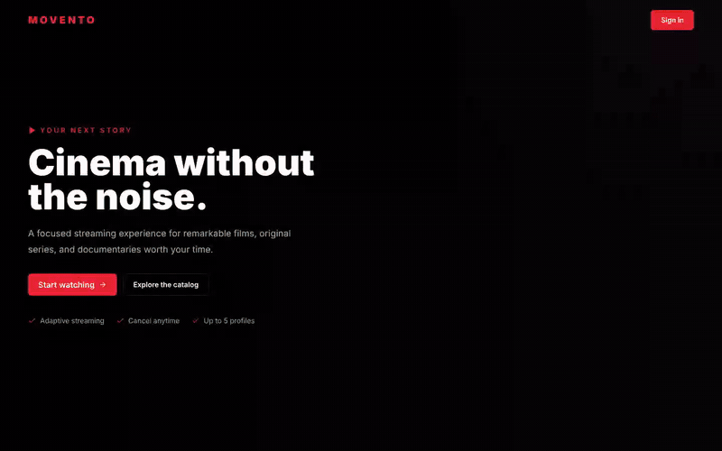

▶ **[Watch the full walkthrough with captions (2.7 min, MP4)](docs/media/movento-walkthrough.mp4)**: sign-up, profiles, the plan gate, test-mode checkout, browsing, My List, playback with resume and next episode, the event-driven *Because you watched* row, search, the kids profile, sign-out and password reset.

| | |
|---|---|
| 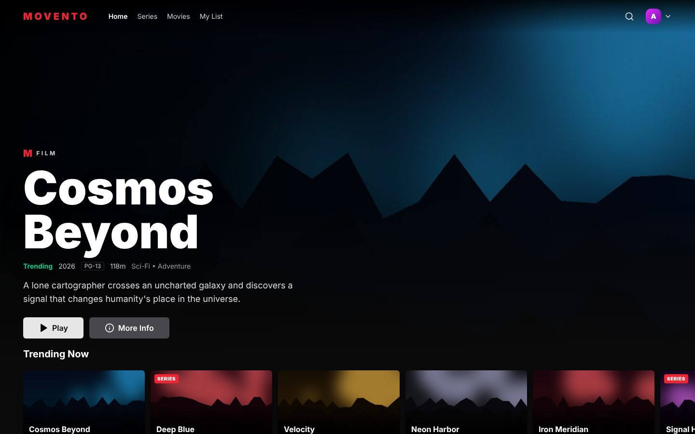 | 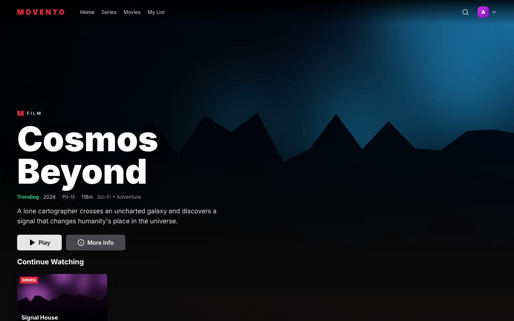 |
| **Home:** billboard, Trending, Top 10, genre rows | **Continue Watching** with progress bars |
| 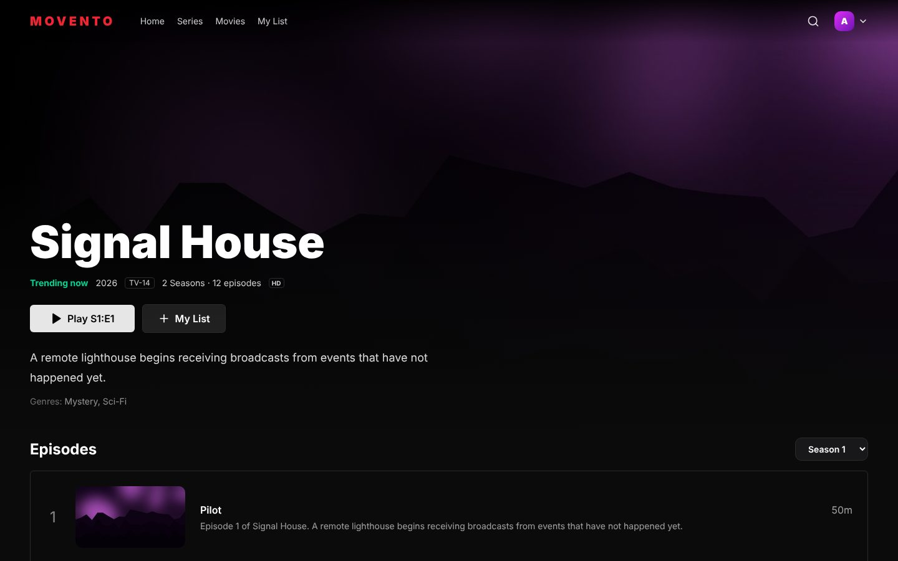 | 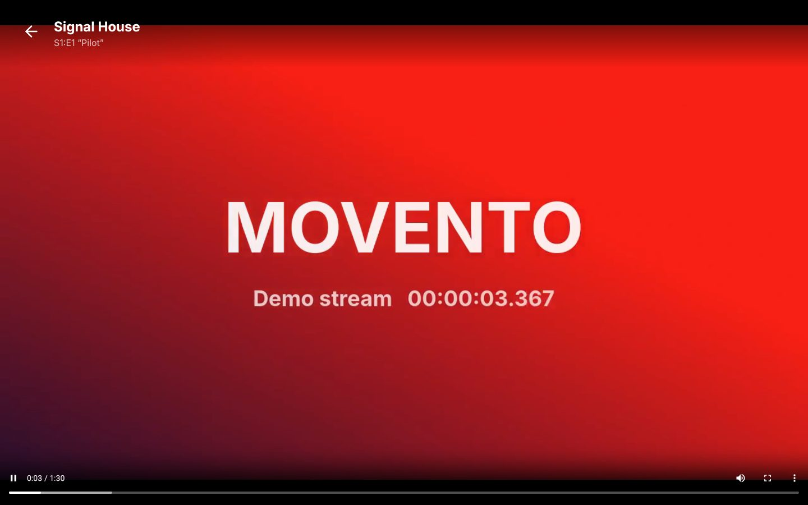 |
| **Title page:** seasons, episodes, More Like This | **Player:** signed HLS stream, resume, next episode |
| 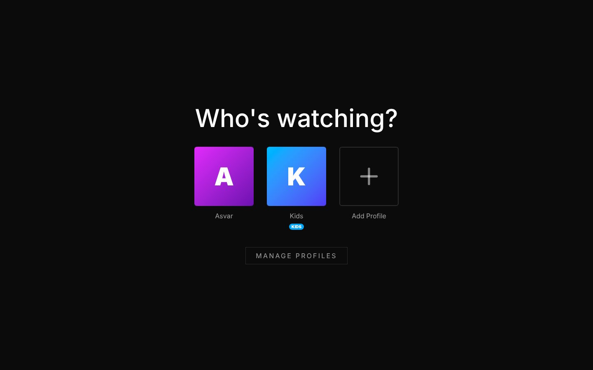 | 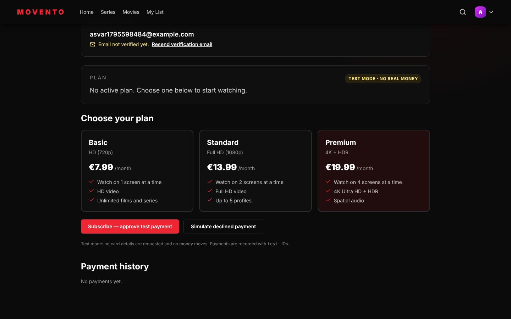 |
| **Who's watching?** with up to 5 profiles, including kids | **Plans:** Basic / Standard / Premium (test mode) |
| 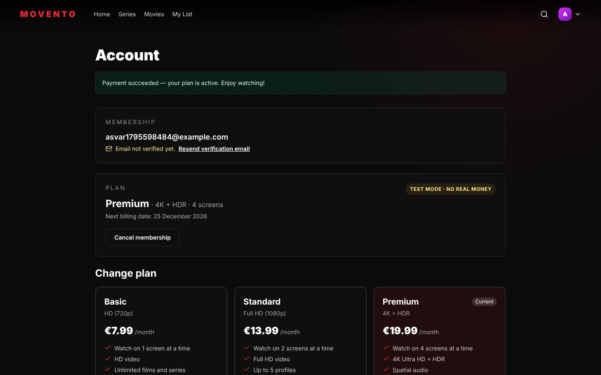 | 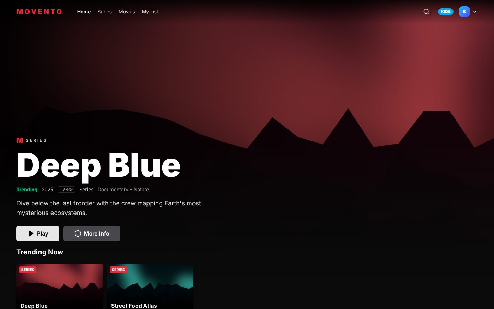 |
| **Account:** plan, cancel/resume, payment history | **Kids profile:** only kids-rated titles |
| 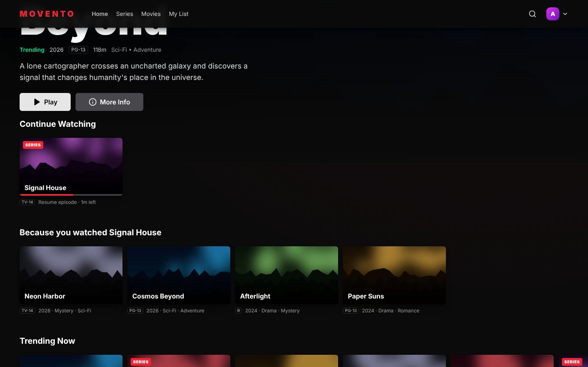 | |
| **Because you watched:** built from playback events via RabbitMQ | |

<sub>The demo was recorded with generated artwork and a generated test stream.</sub>

## Features

**Viewing**
- **Profiles:** a *Who's watching?* gate with up to 5 profiles per account, add and delete, and **kids profiles** whose catalog is filtered on the server by maturity rating (search and direct links included).
- **Home:** a full-bleed billboard plus rows for *Continue Watching* (progress bars), **Because you watched …** (event-driven), *Trending Now*, *Top 10 on Movento Today* (ranked by real plays once there is data), *My List*, *New on Movento*, movies, series and genres. Arrow buttons page through each row.
- **Event-driven recommendations:** every playback start is published to RabbitMQ and consumed by recommendation-service, which powers *Because you watched* and the real Top 10.
- **Title page:** Play / Resume / *Play S1:E1* with the time left, a My List toggle that remembers its state, a season picker with an episode list, and *More Like This* (ranked by shared genres).
- **Player:** full-screen HLS (hls.js) that resumes per episode, saves progress every 10 s and on exit, shows *Next Episode* with an auto-play countdown, and supports keyboard shortcuts (space/k, ←/→, f, Esc).
- **Search** opens right in the header and updates as you type; **Movies and Series pages** have genre rows and an A–Z grid.

**Account and billing**
- Sign up, sign in, and silent session refresh (you stay signed in, keeping the same profile).
- **Email verification and password reset** by email. Locally the emails land in Mailpit at http://localhost:8025.
- **Plans** (Basic €7.99 / Standard €13.99 / Premium €19.99, display prices only) with test-mode checkout (*approve* or *simulate decline*), plan change, cancel and resume, and payment history.
- Playback requires an active plan (HTTP 402 → *Choose a plan*).

## Architecture

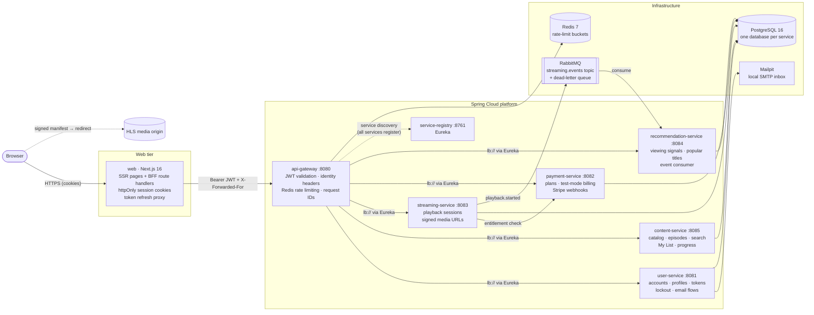

**Event-driven recommendations**

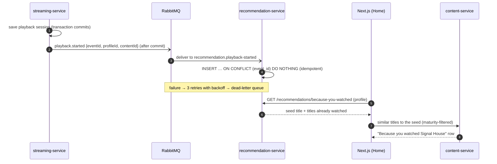

- **Asynchronous and decoupled:** playback never waits for recommendations. If recommendation-service is down, events wait in the durable queue and Home falls back to its catalog rows.
- **At-least-once delivery, processed exactly once in effect:** each event has a UUID `eventId`, and storing it is an idempotent insert, so redeliveries are harmless.
- **Poison messages don't block the queue:** malformed or repeatedly failing messages move to `recommendation.playback-started.dlq` (visible in the RabbitMQ UI) after 3 attempts.
- **Published after commit:** events are sent from a `@TransactionalEventListener(AFTER_COMMIT)`, so consumers never hear about a session that was rolled back. Publishing is best effort; a transactional outbox would make it guaranteed.
- **Versioned JSON contract** (`type`, `version`): each service keeps its own copy of the event record instead of sharing a Java library.
- **Clear ownership:** recommendation-service owns *behaviour* (who watched what, what's popular); content-service owns the *catalog* (titles, genres, similarity, maturity filtering). The web app combines the two.

**How a request flows**

1. The browser only talks to the **Next.js app**. Access and refresh tokens live in `httpOnly` cookies, and a request proxy silently refreshes the 15-minute access token while keeping the selected profile.
2. The Next.js route handlers (`/api/backend/**`, `/api/auth/**`, `/api/media/**`) call the **gateway** with the token and the client IP.
3. The **gateway** first strips any client-supplied identity headers. It then validates the JWT and adds trusted `X-Account-Id`, `X-Profile-Id`, `X-Profile-Maturity`, `X-User-Roles` and `X-Request-Id` headers. It rate-limits auth and playback in Redis and routes to services through **Eureka**.
4. Each service owns its **own PostgreSQL database**, managed by Flyway migrations with Hibernate in `validate` mode.

**Starting playback**

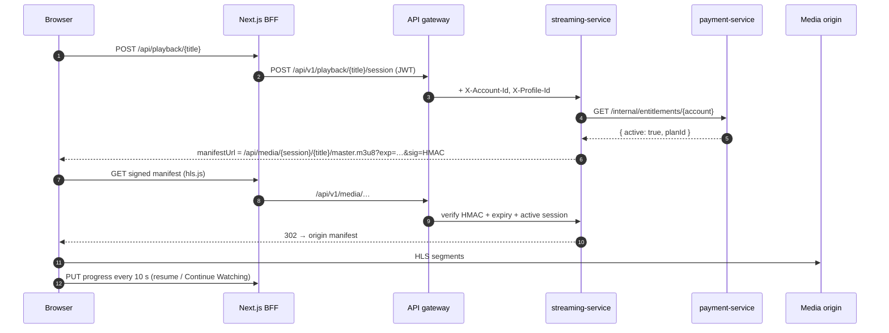

### Services

| Container | Responsibility | Port |
|---|---|---:|
| `web` | Next.js frontend and BFF route handlers | `3000` |
| `api-gateway` | Single API entry point: auth, rate limits, routing | `127.0.0.1:8080` |
| `service-registry` | Eureka discovery | `127.0.0.1:8761` |
| `user-service` | Accounts, profiles, JWT/refresh tokens, lockout, email verification, password reset, admin bootstrap | internal `8081` |
| `content-service` | Catalog, seasons/episodes, search, similar titles, My List, progress, Continue Watching, admin catalog | internal `8085` |
| `streaming-service` | Playback sessions, entitlement check, signed media URLs | internal `8083` |
| `payment-service` | Plans, test-mode billing, payment history, Stripe webhooks, internal entitlements | internal `8082` |
| `recommendation-service` | Consumes `playback.started` events; serves *Because you watched* signals and popular titles; per-account recommendation records | internal `8084` |
| `postgres` / `redis` / `rabbitmq` | Data, rate-limit buckets, playback events (+ dead-letter queue) | `127.0.0.1:15432` / `:16379` / `:15673` |
| `mailpit` | Local inbox for account emails | `127.0.0.1:8025` |

Every container has a healthcheck, a restart policy, log rotation and a memory limit. Infrastructure ports bind to `127.0.0.1` only; PostgreSQL, Redis and RabbitMQ use non-default host ports (15432, 16379, 15673) so they never clash with local installs, and every host port is configurable in `.env`.

### Tech stack

| Layer | Technology |
|---|---|
| Frontend | Next.js 16 (App Router, standalone output), React 19, TypeScript, Tailwind CSS 4, hls.js |
| Gateway | Spring Cloud Gateway (WebFlux), Redis rate limiter, JJWT |
| Services | Java 17, Spring Boot 3.2, Spring Data JPA, Spring Security (user-service), Flyway |
| Infrastructure | PostgreSQL 16, Redis 7, RabbitMQ 3.13 (topic exchange, retries, DLQ), Eureka, Mailpit |
| Delivery | Docker (BuildKit cache, layered jars, non-root), Docker Compose, GitHub Actions, GHCR |

## Run it locally

You only need **Docker Desktop** (or Docker Engine with Compose v2).

```bash
git clone https://github.com/wearthewo/movento.git
cd movento
cp .env.example .env          # optional: the defaults work for local use
docker compose up -d --build  # first build takes a few minutes
docker compose ps             # wait until services show "healthy"
```

| Open | URL |
|---|---|
| App | http://localhost:3000 |
| Mail inbox (verification and reset emails) | http://localhost:8025 |
| Eureka dashboard | http://localhost:8761 |
| RabbitMQ UI (`guest` / `guest`) | http://localhost:15672 |
| Gateway health | http://localhost:8080/actuator/health |

**Try it:** sign up → pick a profile → press Play (you'll be asked for a plan) → choose a plan and *approve the test payment* → watch, leave, and come back to *Continue Watching* and *Because you watched*. In the RabbitMQ UI (http://localhost:15672) you can see the `recommendation.playback-started` queue and its dead-letter queue.

**Default admin** (local only, change it in `.env`): `admin@movento.local` / `Admin123!local`. It is created at startup from `ADMIN_EMAIL` / `ADMIN_PASSWORD`; signing up can never grant admin rights.

Useful commands:

```bash
docker compose logs -f web api-gateway content-service   # follow logs
docker compose up -d --build content-service              # rebuild one service
docker compose down                                        # stop, keep data
docker compose down -v                                     # stop and reset all data
```

### Watching it work

Every service writes short, readable log lines. Ids are logged, never emails, passwords or tokens.

```bash
docker compose logs -f api-gateway                              # one line per request: GET /path -> 200 in 14 ms [req=…]
docker compose logs -f user-service payment-service             # sign-ins, lockouts, profiles, test payments, plan changes
docker compose logs -f streaming-service recommendation-service # playback events: published -> consumed
```

```text
user-service-1            | Signed in account=3
user-service-1            | Profile selected account=3 profile=9c1e… maturity=ADULT
payment-service-1         | TEST MODE payment approved account=3 plan=premium amount=19.99 EUR payment=test_pi_… -> plan active until …
payment-service-1         | Entitlement check account=3 active=true plan=premium
streaming-service-1       | Published playback.started event=3f2a… session=12 account=3 profile=9c1e… content=7
recommendation-service-1  | Consumed playback.started event=3f2a… profile=9c1e… content=7 -> viewing signal stored
```

- To follow one request across services, take its `req=…` id from the gateway line and search all logs for it.
- To see the raw events, open the RabbitMQ UI and bind a temporary queue to the `streaming.events` exchange with routing key `#`, then use *Get messages*.
- To see SQL, set `HIBERNATE_SQL_LOG_LEVEL=DEBUG` for content-service.

## Test-mode payments

- With `STRIPE_PRICE_ID` **empty** (the default), payment-service runs in **test mode**. Plans are activated with simulated payments: choose *Subscribe — approve test payment* or *Simulate declined payment*. There is no card form; payments are saved with `test_pi_…` IDs and a `TEST MODE — … (no real money)` description.
- Subscriptions last 30 days. Cancelling keeps access until the period ends, and *Resume* undoes the cancellation.
- Optional: to try real **Stripe Checkout in test mode**, set `STRIPE_SECRET_KEY` (`sk_test_…`), `STRIPE_PRICE_ID` (`price_…`) and `STRIPE_WEBHOOK_SECRET`, then deliver webhooks to `POST /api/v1/webhooks/stripe` (for example with `stripe listen`). Use the test card `4242 4242 4242 4242`.
- Set `PLAYBACK_REQUIRE_SUBSCRIPTION=false` to allow playback without a plan.

## Security

| Concern | Protection |
|---|---|
| Identity spoofing | The gateway removes client-supplied `X-Account-Id`, `X-Profile-Id`, `X-Profile-Maturity`, `X-User-Email`, `X-User-Roles` and `X-Subscription-Status` on **every** route, then re-derives them from a verified JWT (issuer checked). |
| Token theft | Tokens live only in `httpOnly`, `SameSite=Lax` cookies (`Secure` in production). Refresh tokens are stored hashed (SHA-256) and rotated on every use. **Reuse of an old token revokes every session** of the account, with a 30-second grace window for parallel requests. |
| Password guessing | Redis rate limit on `/api/v1/auth/**` (≈10 requests per minute per client IP), plus an **account lockout** after 5 wrong passwords (15 minutes). |
| Account recovery | Single-use, hashed email tokens (verification: 24 h; reset: 30 min). Responses never reveal whether an email is registered. A password reset signs out every device. |
| Admin access | The admin account is bootstrapped from env vars only; public sign-up always creates a regular viewer. `/api/v1/admin/**` requires `ROLE_ADMIN` at the gateway. |
| Authorization | Library data is scoped to the profile; recommendations and playback sessions check ownership; recommendation writes are admin-only. |
| Content access | Kids profiles are filtered on the server (maturity claim in the JWT). Playback requires an active plan, checked service-to-service on an internal endpoint that the gateway never routes. |
| Media links | Manifest URLs are **HMAC-SHA256 signed**, bound to session and title, and expire after 15 minutes (verified in constant time), much like CDN signed URLs. |
| Exposure | Only the web app is published; infrastructure ports are bound to `127.0.0.1`. Actuator exposes health/info/metrics only (no env/heapdump). Logs never include cookies, auth headers or SQL bind values. Containers run as non-root. |

Known limits of a local project: video segments come from a public test stream (no DRM), concurrent-screen limits are shown per plan but not enforced, and email-link scanners could consume a verification link early.

## Performance

- The **home feed** is built in one query (titles plus genres via an entity graph), then cached in memory per maturity level for 60 s and invalidated whenever an admin edits the catalog.
- **Paging** on `GET /api/v1/catalog/titles?page=&size=` (with an `X-Total-Count` header); catalog scans are capped.
- Indexes for the hot paths: Continue Watching, My List, active refresh tokens and account tokens.
- Guests get Next.js-cached catalog pages (120 s revalidation); signed-in pages are rendered per profile.
- Docker images: dependency layers are cached by BuildKit, Spring Boot jars are split into layers, and the JVM is container-aware (`MaxRAMPercentage=75`).

## API overview

All routes go through the gateway at `/api/v1`.

| Area | Endpoints |
|---|---|
| Auth (public, rate limited) | `POST auth/register`, `auth/login`, `auth/refresh`, `auth/logout`, `auth/verify-email`, `auth/resend-verification`, `auth/forgot-password`, `auth/reset-password` |
| Users | `GET users/me`, `GET/POST users/me/profiles`, `PUT/DELETE users/me/profiles/{id}`, `POST users/me/profiles/{id}/select` |
| Catalog (optional auth) | `GET catalog/home`, `catalog/titles?type=&genre=&q=&ids=&page=&size=`, `catalog/search?q=`, `catalog/titles/{slug}`, `…/{slug}/episodes`, `…/{slug}/similar` |
| Library (profile) | `GET library/continue-watching`, `GET library/watchlist/titles`, `GET/PUT/DELETE library/watchlist/{id}`, `GET/PUT library/progress/{id}` |
| Playback | `POST playback/{titleId}/session`, `POST playback/sessions/{id}/complete`, `GET media/{session}/{title}/master.m3u8?exp=&sig=` |
| Recommendations (profile) | `GET recommendations/because-you-watched`, `GET recommendations/popular?days=&limit=` |
| Billing | `GET billing/plans`, `GET billing/subscription`, `GET billing/payments`, `POST billing/checkout`, `billing/change-plan`, `billing/cancel`, `billing/resume` |
| Admin | `POST/PUT/DELETE admin/catalog/…`, `POST admin/catalog/{id}/publish` |

## Project structure

```text
movento/
├── web/                     Next.js app (pages, BFF route handlers, proxy.ts token refresh)
├── api-gateway/             Spring Cloud Gateway: auth filter, header sanitizer, rate limiting
├── service-registry/        Eureka server
├── user-service/            accounts, profiles, tokens, lockout, email flows (Flyway V1–V4)
├── content-service/         catalog, episodes, library, caching (Flyway V1–V10)
├── streaming-service/       playback sessions, entitlement check, signed media URLs
├── payment-service/         plans, test-mode billing, Stripe webhooks
├── recommendation-service/  playback-event consumer, viewing signals, popular titles (Flyway V1–V2)
├── docker/                  shared Dockerfile for every Spring service
├── docker-compose.yml       local stack
├── docker-compose.prod.yml  optional single-server overlay (Caddy HTTPS, GHCR images)
├── docs/                    screenshots and demo video
└── .github/workflows/       CI/CD
```

## Development

```bash
./mvnw clean verify                               # all backend modules + tests
./mvnw -pl content-service -am package -DskipTests

cd web && npm ci && npm run lint && npm run typecheck && npm run build
```

On Windows, `scripts/local-ci.ps1` runs the same checks as CI. If antivirus HTTPS interception breaks Maven or npm inside Docker, put its root certificate (`.pem`) in `.local-certs/`; every image trusts certificates found there. They are git-ignored.

## CI/CD (GitHub Actions)

1. **backend:** `./mvnw verify` (unit tests include signed media URLs, the plan gate, refresh-token reuse, the playback event producer and the idempotent consumer).
2. **frontend:** lint, typecheck, production build.
3. **docker:** builds all 8 images with a GitHub Actions cache, and publishes them to `ghcr.io/<owner>/movento/<service>` on pushes to the release branch, to `main`, or on `v*` tags.
4. **compose:** starts the full stack and smoke-tests it: routing, Eureka registration, spoofed headers rejected, home feed and episodes, **login rate limiting (429)**, **playback refused without a plan (402)**, test-mode checkout, a signed manifest URL, then the **event flow end to end** (playback → RabbitMQ → *Because you watched* and popular) with an empty dead-letter queue.

## Optional: single-server deployment

The project is meant to run locally from GitHub, but `docker-compose.prod.yml` shows how the same images would run on one server. It pulls images from GHCR, refuses to start without real secrets, publishes no internal ports, and puts Caddy (automatic HTTPS) in front, exposing only the web app and the Stripe webhook.

```bash
docker compose -f docker-compose.yml -f docker-compose.prod.yml up -d
```

## Troubleshooting

- **"ports are not available … bind: An attempt was made to access a socket in a way forbidden by its access permissions"** (Windows): the port is used by another program (for example a local PostgreSQL) or reserved by Windows (`netsh interface ipv4 show excludedportrange protocol=tcp`). Pick another port in `.env` (for example `POSTGRES_HOST_PORT=25432`) and run `docker compose up -d` again. Databases are published on `15432`/`16379`/`15673` by default to avoid clashes.
- **The first request is slow:** services are still registering with Eureka. Run `docker compose ps` and wait for `healthy`.
- **"Choose a plan" when pressing Play:** expected. Subscribe in test mode on the Account page, or set `PLAYBACK_REQUIRE_SUBSCRIPTION=false`.
- **"Too many attempts":** the auth rate limit or account lockout was triggered. Wait a minute (lockout: 15 minutes), or reset your password.
- **RabbitMQ cookie permission error:** `docker volume rm movento_rabbitmq_data && docker compose up -d rabbitmq`.
- **A service exited:** `docker compose logs --tail=200 <service>`.
